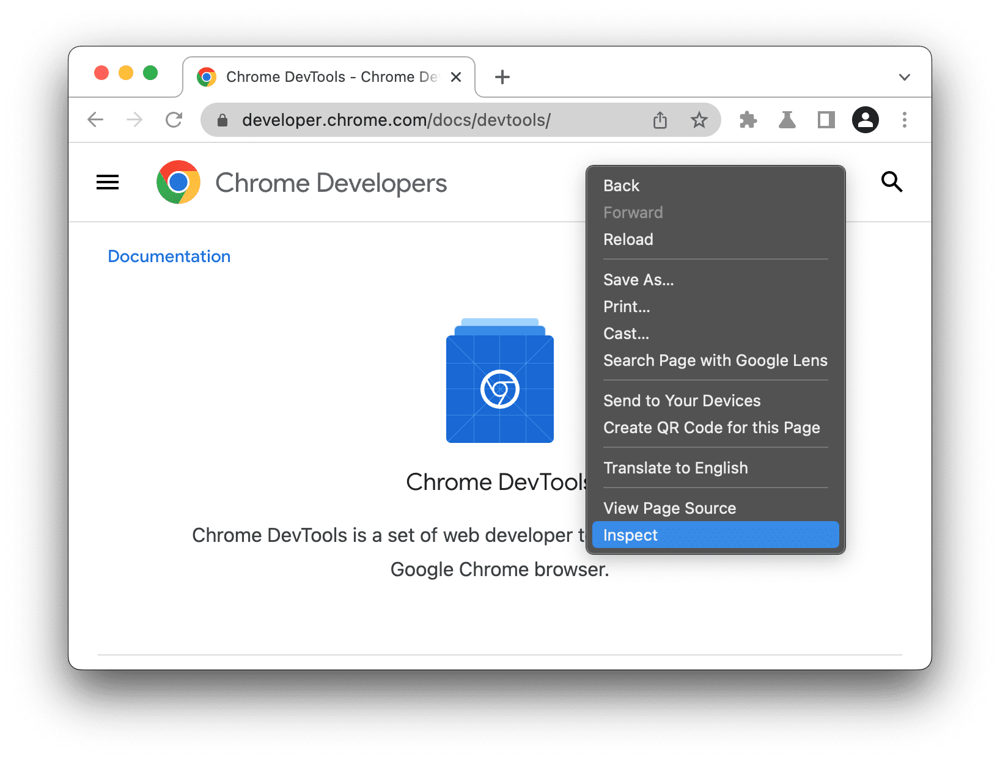
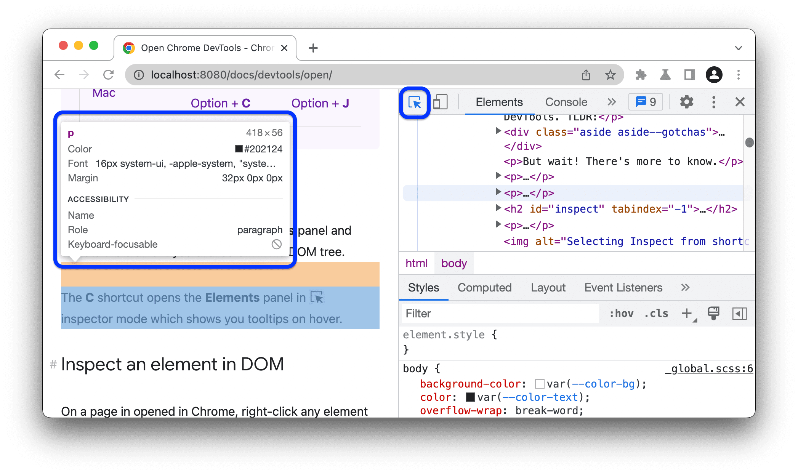

Waktu kamu membuat website, kamu bisa mengalami kejadian seperti ini:
* Warnanya ingin diganti sedikit lebih terang, tapi malas bolak-balik ubah kode di VS Code, simpan file, lalu tekan refresh di browser berkali-kali?
* Ada kotak kartu yang posisinya berantakan atau teksnya terpotong, tapi kamu bingung baris kode CSS mana yang jadi penyebabnya?

Cara cek-nya gampang kok! Semua programmer di seluruh dunia menggunakan satu "senjata rahasia" bawaan browser untuk mengatasi masalah ini: **Inspect Element (Developer Tools)**.

## Apa Itu Inspect Element?

**Inspect Element** adalah alat yang memungkinkanmu melihat langsung kerangka HTML dan aturan CSS dari website apa pun di dunia secara *real-time*.

Bukan cuma melihat, kamu bahkan bisa **mengubah tulisan, mengganti warna, dan menggeser layout-nya langsung di depan matamu**!

Satu hal penting yang sering membuat pemula ragu: *"Kalau saya ubah kodenya di Inspect Element, apakah websitenya bakal rusak beneran?"*

Jawabannya: **Sama sekali tidak!**

Perubahan yang kamu lakukan di Inspect Element hanya terjadi di memori browsermu sendiri secara sementara. Server website aslinya tidak akan pernah terpengaruh. Begitu kamu menekan tombol **Refresh (F5)** pada browser, halaman web akan kembali bersih seperti semula. 

Itulah kenapa Inspect Element sering dipakai sebagai tempat bermain dan bereksperimen dengan desain untuk memahami desain tersebut!

## Mengenal Sekilas tentang Inspect Tools

Saat jendela Developer Tools terbuka di samping atau bawah layar, ada 3 panel utama yang paling sering kita gunakan:

### 1. Kursor Penunjuk Elemen (Inspect Cursor)
Di pojok kiri atas jendela DevTools, ada ikon panah kecil (atau shortcut `Ctrl + Shift + C` di Windows / `Cmd + Shift + C` di Mac). 
Klik ikon tersebut, lalu arahkan kursor ke elemen mana pun di layar website yang ingin kamu bedah. DevTools akan langsung melompat dan menyorot baris HTML serta CSS yang bertanggung jawab atas elemen itu.

### 2. Panel Elements (Struktur HTML)
Menampilkan struktur HTML halaman secara utuh. Kamu bisa klik ganda pada teks apa pun di sini untuk mengganti isinya langsung. (Misal: mengganti saldo di web simulasi bank jadi 1 Miliar. Tapi ini cuma ada di layarmu sendiri ya!).

### 3. Panel Styles (Toggle CSS)
Di sebelah kanan panel Elements, ada tab **Styles**. Di sini kamu bisa:
- Mencentang atau mematikan centang pada aturan CSS untuk melihat efeknya tanpa harus menghapus kode di editor.
- Mengetik properti baru langsung di baris kosong (misal menambahkan `background-color: salmon;`).
- Menggeser angka padding/margin menggunakan tombol panah atas/bawah pada keyboard atau mengganti nilainya untuk melihat perubahannya mengembang secara halus di layar.

## Latihan Kasus Nyata: Menyembuhkan Website Rusak

Untuk mengasah insting analisismu, kami sudah menyiapkan satu paket latihan website sederhana yang sengaja dibuat agak "berantakan" tata letaknya.

> 📦 **Unduh Berkas Latihan:** [Download `latihan-inspect-rit.zip`](assets/downloads/latihan-inspect-rit.zip) *(Ekstrak foldernya di laptopmu, lalu buka `index.html` di browser).*

Di dalam file latihan tersebut, kamu akan menemukan 2 masalah klasik pemula:
1. **Masalah 1 (Teks Menempel di Dinding):** Ada sebuah kartu pengumuman yang teksnya menempel persis ke garis bingkai tanpa ruang napas.
   * *Tantangan:* Gunakan Inspect Element untuk mencari elemen kartu tersebut, lalu tambahkan `padding: 16px;` di tab Styles. Lihat bagaimana teksnya langsung memiliki ruang napas yang nyaman!
2. **Masalah 2 (Gambar Raksasa Bablas Keluar Layar):** Ada gambar poster kegiatan yang ukurannya terlalu besar sehingga membuat halaman harus digeser ke kanan-kiri (*horizontal scroll* yang merusak tampilan).
   * *Tantangan:* Sorot gambarnya, lalu coba tambahkan aturan `max-width: 100%; height: auto;` agar lebarnya otomatis menurut pada batas layar pembungkusnya.

Setelah tampilannya terlihat rapi dan pas di Inspect Element, salin nilai CSS yang berhasil tersebut ke file `style.css` aslimu di VS Code, lalu simpan permanen. Inilah siklus kerja nyata seorang web developer profesional!

## Ringkasan
- Inspect Element (F12) adalah alat rontgen dan meja uji coba desain langsung di dalam browser.
- Semua perubahan di Inspect Element bersifat lokal dan sementara; menekan Refresh akan mengembalikan halaman ke kondisi awal.
- Gunakan Kursor Penunjuk Elemen untuk mencari tahu baris kode yang mengatur tampilan tertentu.
- Tab Styles dipakai untuk mencoba-coba warna, padding, dan perbaikan tata letak sebelum disalin permanen ke editor kode.

Sekarang meja kerja lokalmu sudah siap, dan kamu sudah tahu cara mendiagnosis kode jika ada tampilan yang bermasalah. Di modul berikutnya, kita akan berkenalan dengan **Git & GitHub** untuk menyimpan catatan sejarah kodemu ke awan!

Sudah mencoba fitur Inspect di browsermu? Jawab checkpoint di bawah ini 👇