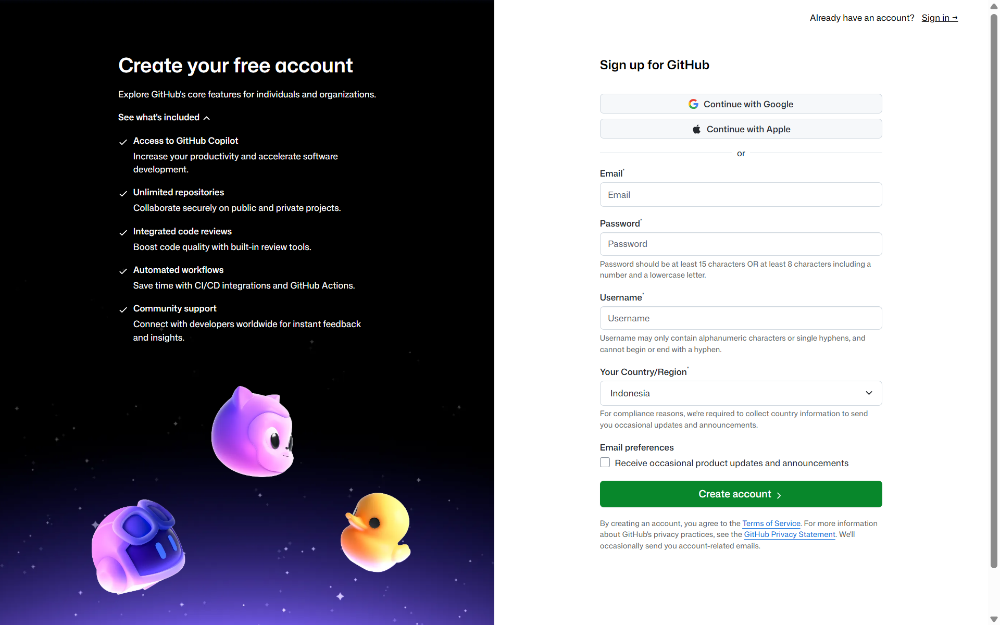
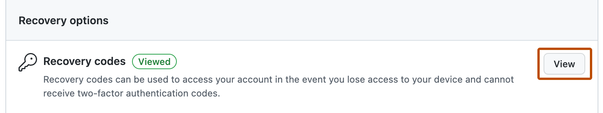
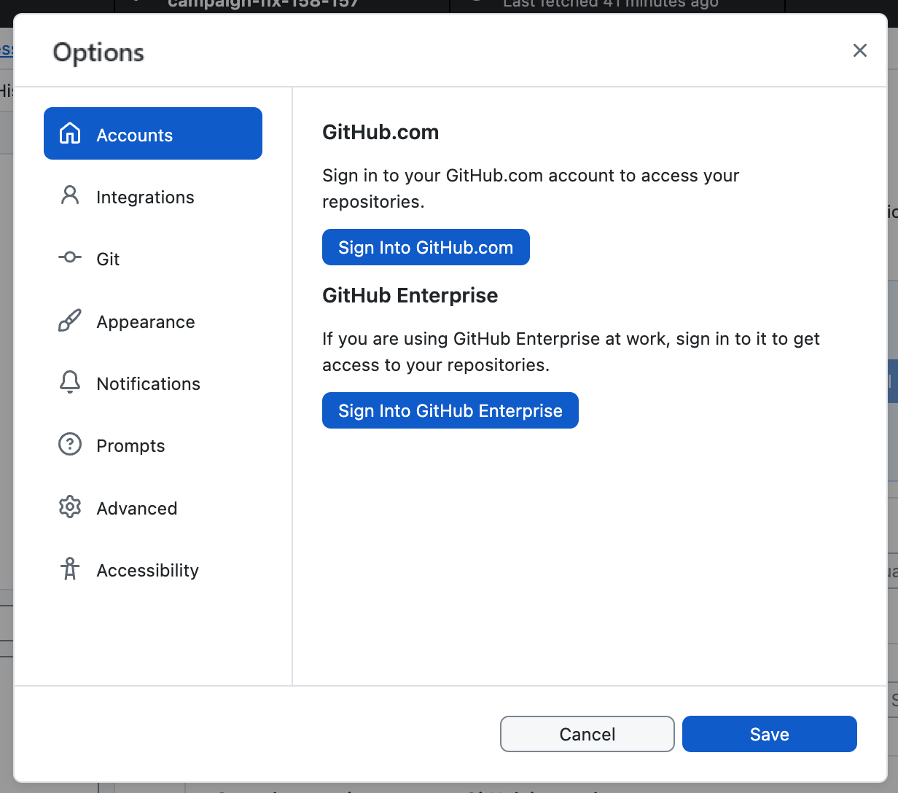

Pernahkah kamu mengerjakan tugas kelompok dan file dokumennya diberi nama seperti `tugas_akhir.docx`, lalu besoknya direvisi jadi `tugas_akhir_fix.docx`, dan lusa direvisi lagi jadi `tugas_akhir_fix_beneran_terakhir_banget.docx`?

Saat kita membuat website, kode HTML dan CSS kita akan terus berubah seiring waktu. Kalau kita menggunakan cara manual "ganti nama file" seperti tadi, revisi kodenya bikin tambah pusing lagi!

Di sinilah **Git** dan **GitHub** datang sebagai penyelamat hidup para programmer.

> **Fun Fact:** *Git diciptakan oleh Linus Torvalds (orang yang sama yang menciptakan sistem operasi Linux) hanya dalam waktu beberapa hari pada tahun 2005 karena dia frustrasi dengan sistem pencatat kode yang ada saat itu. Sekarang, lebih dari 100 juta programmer di seluruh dunia menggunakan ekosistem ini setiap hari!*

## Kenapa Pakai GitHub?

Bayangkan kamu sedang bermain game petualangan yang sulit. Agar tidak mengulang dari nol saat karaktermu kalah, kamu pasti rajin membuat **Save Point (Checkpoint)**.

Nah, **Git** adalah sistem pembuat *checkpoint* otomatis untuk setiap baris kodemu. Sementara **GitHub** platform khusus programmer untuk mencadangkan catatan kodemu ke awan (cloud), memamerkan karya ke publik, serta berkolaborasi dengan teman setim tanpa takut kodenya saling bertabrakan.

## Git (Di Komputermu) vs GitHub (Di Awan)

Seringkali pemula mengira Git dan GitHub itu hal yang sama. Padahal mereka adalah dua hal yang berbeda:
- **Git:** Adalah aplikasi pencatatnya untuk membuat riwayat versi yang bekerja di komputermu sendiri. Git mencatat siapa yang mengubah kode apa dan pada jam berapa.
- **GitHub:** Adalah platform web / layanan awan tempat kamu menitipkan catatan Git tersebut agar aman di internet dan bisa diakses dari mana saja.

## Kenapa RIT Academy Memilih GitHub?

Ada banyak platform penyimpan kode di dunia (seperti GitLab atau Bitbucket), tapi GitHub saat ini  standar mutlak di industri teknologi karena:
1. **Ajang Showcase Programmer:** Di dunia kerja IT, akun GitHub seringkali lebih dilihat daripada selembar CV kertas. Rekruter bisa melihat riwayat kodingmu secara nyata.
2. **Pusat Komunitas Open Source:** Jutaan proyek perangkat lunak bebas di dunia berkumpul dan berkolaborasi di GitHub.
3. **Fitur-Fitur dukungan Coding (seperti Github Pages):** GitHub mmeiliki bayak fitur yang bisa membantu programmer dalam mengelola 

---

## Langkah 1: Mendaftar Akun GitHub

Mari kita buat akun GitHub sekarang juga:

1. Buka browser dan kunjungi **[github.com/signup](https://github.com/signup)**.
2. Masukkan alamat email aktifmu dan buat password yang kuat.
3. **Pilih Username yang Kamu Mau:** Jangan lupa username ini bakal jadi alamat portofolio kamu. (misalnya: `https://github.com/namamu`).
4. Selesaikan verifikasi captcha dan masukkan kode konfirmasi yang dikirim ke emailmu.

---

## Langkah 2: Mengamankan Akun (Wajib 2FA & Titik Kritis Recovery Codes)

Saat ini, GitHub mewajibkan semua pengguna mengaktifkan **2FA (Two-Factor Authentication)** demi keamanan akun dari peretasan.

1. Pasang aplikasi **GitHub Mobile** di smartphone-mu (tersedia gratis di Play Store dan App Store).
2. Ikuti panduan di layar untuk memindai kode QR atau menghubungkan aplikasi autentikasi.
3. Unduh & Amankan "Recovery Codes"**
   * Tepat setelah 2FA aktif, GitHub akan menampilkan sekumpulan **Recovery Codes (Kode Pemulihan Darurat)**.
   * **Wajib klik tombol Download / Salin kode tersebut**, lalu simpan file `.txt` itu di Google Drive atau catatan rahasia pribadimu!
   * *Kenapa harus dilakukan?* Jika suatu hari HP-mu rusak, hilang, atau aplikasi authenticator terhapus, **hanya Recovery Codes yang bisa dipakai untuk membuka kembali akun GitHub-mu**. Jangan dilewat ya!

---

## Langkah 3: Menyiapkan GitHub Desktop di Komputer atau Laptop

Banyak tutorial pemula yang langsung memaksa menghafal perintah Terminal yang rumit (`git init`, `git add`, `git commit`, `git push`). Walaupun command terminal perlu diketahui, di RIT Academy  kita ingin kamu fokus memahami alur logikanya terlebih dahulu tanpa stres!

Oleh karena itu, kita akan menggunakan aplikasi resmi **GitHub Desktop**:

1. Unduh dan pasang aplikasinya di **[desktop.github.com](https://desktop.github.com)**.
2. Buka aplikasi GitHub Desktop, lalu klik menu **Sign in to GitHub.com**.
3. Browser akan terbuka untuk meminta izin login. Klik **Authorize desktop**.
4. Selesai! Laptopmu sekarang sudah resmi terhubung dengan akun GitHub di awan.

> 📱 **Jalur Khusus Pengguna HP (Tanpa Laptop):**
> *Kalau kamu sedang belajar menggunakan smartphone, kamu tidak perlu mengunduh GitHub Desktop! Kamu cukup membuka repositori GitHub-mu di browser Chrome HP, lalu ubah alamat `github.com/...` menjadi **`github.dev/...`** untuk membuka VS Code versi web resmi langsung di layar HP-mu!*

## Ringkasan
- Git adalah buku catatan riwayat perubahan di laptopmu; GitHub adalah platform awan penyimpan buku catatan tersebut.
- Akun GitHub berfungsi sebagai paspor digital dan portofolio utama seorang programmer.
- Gunakan username profesional dan amankan akun dengan 2FA.
- **Recovery Codes wajib diunduh dan disimpan di tempat aman** agar tidak terkunci permanen dari akunmu sendiri.
- GitHub Desktop memudahkan proses pencatatan dan pengiriman kode tanpa harus mengetik perintah terminal yang membingungkan.

Akun sudah siap, meja kerja lokal sudah terhubung. Di modul berikutnya, kita akan menerbangkan website lokal yang sudah kamu buat ke internet agar bisa diakses oleh siapa pun di dunia!

Sudah paham alur Git & GitHub? Selesaikan kuis checkpoint di bawah ini 👇