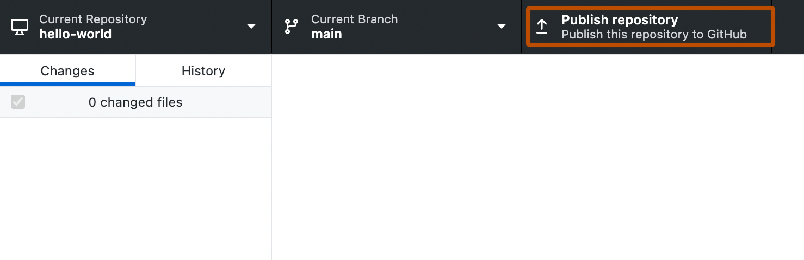
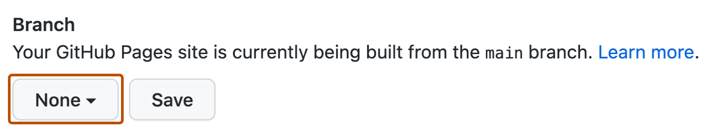
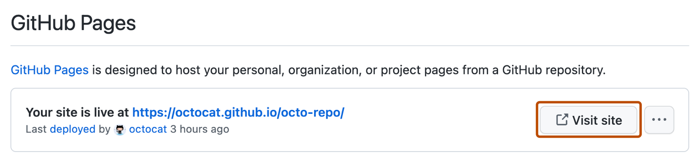

Punya website dengan tata letak rapi, warna estetik, dan struktur yang bersih di komputermu itu keren. Tapi namanya website yaaa diciptakan untuk bisa diakses di **internet** agar bisa dinikmati oleh orang banyak.

Kalau kodenya cuma ada di laptopmu dan kamu membukanya dengan klik dua kali file HTML di browser, perjalanan belum usai! Sekarang saatnya kita simpan karyamu di arsip internet yang luas agar bisa dibuka langsung dari HP teman sebangku atau keluargamu (**Deployment**).

## Kenapa Website Harus Di-deploy? (Jebakan `file:///...`)

Tautan berawalan `file:///` itu menunjuk langsung ke **harddisk fisik laptopmu sendiri**. Orang di luar rumahmu tidak memiliki akses masuk ke dalam laptopmu. Agar bisa dibuka oleh dunia, file-file websitemu harus dititipkan di komputer yang selalu menyala dan terhubung ke jaringan internet global 24 jam sehari (yaitu *Server*).

## Mengenal Hosting dan Domain

Untuk membuat websitemu online, kamu butuh dua pilar infrastruktur dasar:

1. **Hosting:** Hosting itu tempat kamu menyewa komputer server yang menyala 24 jam tanpa henti untuk menaruh file website agar bisa dijalankan dan diakses oleh banyak orang.
2. **Domain:** Domain itu alamat unik di dunia maya (contoh: `google.com` atau `rit-base.org`) agar orang tidak perlu repot mengetik deretan angka IP address yang membingungkan.

## Kenapa Kita Memilih GitHub Pages?

Biasanya, menyewa server hosting dan membeli domain itu membutuhkan biaya bulanan atau kartu kredit. Tapi untuk mahasiswa dan pemula, GitHub menyediakan fasilitas istimewa bernama **GitHub Pages**:

* **100% Gratis & Tanpa Kartu Kredit:** Sangat ramah untuk pelajar.
* **Zero Maintenance:** Kamu tidak perlu pusing mengurus sistem operasi Linux server, keamanan server, atau kabel jaringan.
* **Terintegrasi Portofolio:** Sekali kamu mengunggah kodemu ke GitHub, websitemu otomatis memiliki alamat resmi: `https://username.github.io/nama-proyek/`.

> **Fun Fact:** *"Kok bisa GitHub gratis, dermawan banget!" GitHub menyediakan fitur-fitur gratis ini agar developer sudah terbiasa dengan lingkungan kerja mereka. Pemakaian pribadi di GitHub pastinya tidak sebanyak perusahaan, jadi nggak merugikan mereka sama sekali. Sebaliknya, ketika perusahaan perlu develeoper, mereka sudah terbiasa dengan lingungan kerja GitHub. Alhasil untuk menunjang perusahaan, mereka akhirnya jadi bayar layanan GitHub karena penggunaannya lebih banyak sampai perlu berbayar.*

---

## Langkah 1: Memeriksa Kesiapan Berkas Lokal

Sebelum mengunggah, pastikan kembali isi folder proyekmu (`profil-saya`) sudah mematuhi **Aturan Emas** yang kita pelajari di Modul 07:
1. File halaman utama **wajib bernama persis `index.html`** (semua huruf kecil, tanpa spasi).
2. File `style.css` berada di folder yang sama.
3. Gambar tersimpan rapi di dalam sub-folder `assets/`.

---

## Langkah 2: Mengunggah Proyek via GitHub Desktop

Buka aplikasi **GitHub Desktop** yang sudah kita siapkan di modul sebelumnya:

1. Klik menu **File ➔ Add Local Repository** (atau shortcut `Ctrl + O`).
2. Klik tombol **Choose...**, lalu arahkan ke folder `profil-saya` di komputermu, lalu klik **Add Repository**.
3. Di bagian bilah atas, klik tombol biru **Publish repository**.
4. Akan muncul jendela pengaturan:
   - **Name:** Biarkan tetap `profil-saya`.
   - **Description:** Tulis deskripsi singkat, misalnya: *"Website kartu profil pertama di RIT Academy"*.
   - ⚠️ **TITIK KRITIS (Wajib Perhatikan):**
     **Hilangkan tanda centang pada opsi [ ] "Keep this code private"!**
     *Kenapa?* Karena pada akun GitHub gratis, fitur GitHub Pages **hanya bisa aktif jika repositori berstatus Public**.
5. Klik tombol **Publish repository**. Tunggu beberapa detik sampai proses unggah selesai.

---

## Langkah 3: Mengaktifkan Fitur GitHub Pages

Sekarang repositorimu sudah ada di GitHub. Langkah terakhir adalah menyalakan saklar hostingnya:

1. Buka browser dan masuk ke akun GitHub-mu, lalu buka repositori `profil-saya` yang baru saja kamu publish.
2. Klik tab **Settings** (ikon roda gigi di bilah menu kanan atas repositori).
3. Pada bilah menu sebelah kiri, cari dan klik menu **Pages** (ada di bawah bagian *Code and automation*).
4. Di bagian **Build and deployment**:
   - Pada kolom *Source*, pilih **Deploy from a branch**.
   - Pada pilihan *Branch*, ubah dari `None` menjadi **`main`** (dengan folder `/ (root)`).
5. Klik tombol **Save**!

---

## Langkah 4: Memantau Actions & Buka Web Live!

Setelah kamu menekan tombol *Save*, jangan panik jika link-nya belum langsung bisa dibuka!

Di balik layar, ada proses bernama **GitHub Actions** yang sedang merakit dan menyebarkan file websitemu ke server-server global. Proses ini biasanya membutuhkan waktu sekitar **1 hingga 2 menit**.

1. Refresh halaman pengaturan Pages setelah 1–2 menit.
2. Di bagian atas layar akan muncul kotak hijau bertuliskan:
   > **"Your site is live at https://username.github.io/profil-saya/"**
3. Klik tombol **Visit site** atau salin alamat tersebut, lalu buka langsung di browser smartphone-mu. Jreng! Websitemu sekarang sudah resmi mengudara di dunia nyata!

## 🛠️ Gimana Kalau Error Setelah Upload?

Kalau kamu membuka link dan menemukan tulisan *404 File Not Found*, cek 3 hal ini:
- **Apakah baru saja klik Save?** Tunggu 1 menit lagi, server masih menyelesaikan proses rakitnya.
- **Apakah nama file utama salah?** Pastikan namanya persis `index.html` (bukan `Index.html`, `home.html`, apalagi `index.html.txt`).
- **Apakah repositori tidak sengaja tersetel Private?** Masuk ke `Settings ➔ Danger Zone` dan ubah visibility menjadi **Public**.

## Ringkasan
- Link lokal `file:///...` hanya bisa dibuka di komputermu sendiri dan butuh di-deploy agar bisa diakses publik.
- **Hosting** adalah rumah server penyimpan file; **Domain** adalah alamat penunjuknya.
- **GitHub Pages** memberikan hosting gratis untuk website statis (HTML, CSS, JS).
- Saat mem-publish repositori, **pastikan opsi Private tidak dicentang** (harus Public).
- Aktifkan Pages di menu `Settings ➔ Pages`, pilih branch `main`, lalu simpan.

Kini websitemu sudah mengudara di internet! Di modul pamungkas berikutnya, kita akan menyatukan semua ilmu yang telah kamu pelajari untuk merancang **Web Portofolio Pribadi** yang siap kamu pamerkan ke publik!

Sudah paham cara menerbitkan website? Jawab checkpoint di bawah ini 👇