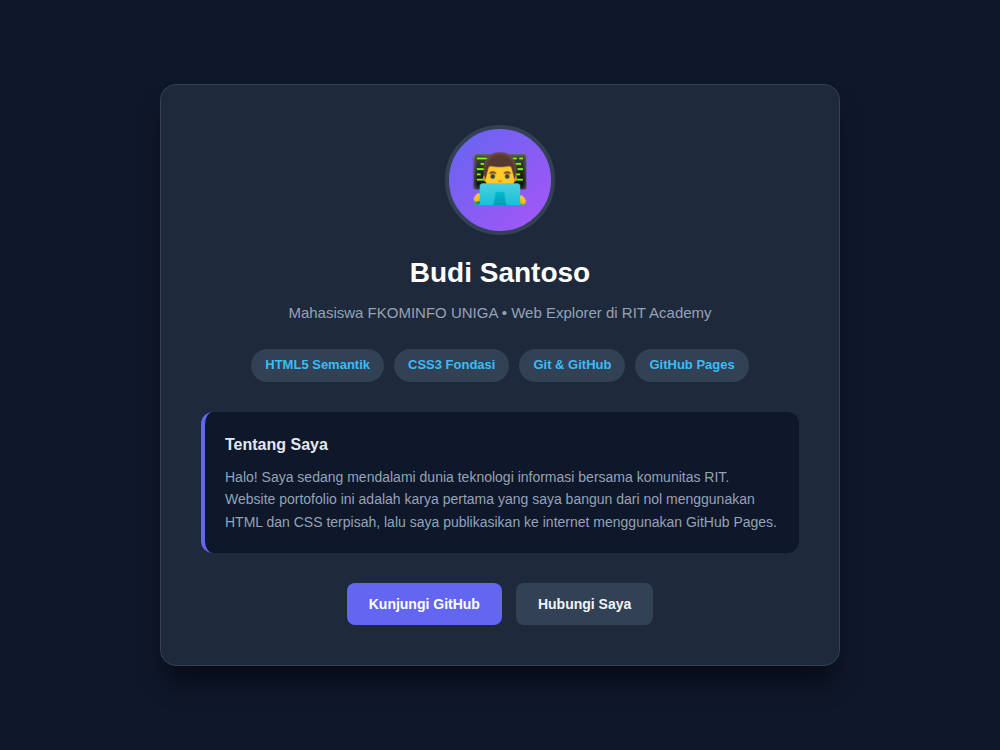

Selamat, Penjelajah Web! Kamu telah menempuh perjalanan yang luar biasa dari nol. 

Dari awalnya hanya mengenal cara kerja browser dan server, menyusun kerangka dokumen dengan HTML Semantik, mendandani tata letak dan warna dengan CSS, jalanin website di laptop, hingga menerbitkan websitemu ke internet menggunakan Git & GitHub Pages. 

Sekarang saatnya membuktikan semua pemahaman tersebut dalam satu karya: **Membuat Web Pribadimu**. Websitenya boleh apa aja, namun kalau bingung bisa website portofolio.

## Kenapa Tugasnya Begini?

Di dunia teknologi (IT), **Portofolio jauh lebih berdampak daripada selembar ijazah atau sertifikat seminar.** 

Ketika kamu menunjukkan tautan website hasil tanganmu sendiri kepada calon klien, dosen, atau tim rekruter perusahaan, mereka bisa langsung melihat bukti nyata kemampuanmu:
- Apakah struktur kodenya rapi dan semantik?
- Apakah desainnya nyaman dibaca di layar HP maupun laptop?
- Apakah tautannya benar-benar bisa diakses internet?
- Apakah performanya ringan dan cepat?
- Apakah aplikasinya aman dari ancaman keamanan siber?

Makanya produk-produk buatan kamu jauh lebih terpercaya untuk menunjukan kemampuanmu daripada pengalaman tertulis yang sulit dibuktikan!

## Rancang Website milikmu

Kalau kamu mau nyoba buat website portofolio pribadi, struktur ini bisa dijadikan referensi:

1. **Header / Hero Section:** Wajah utama websitemu. Berisi foto profil (tag ``), nama lengkapmu (`<h1>`), dan kalimat perkenalan singkat yang menarik (misal: *"Halo, saya mahasiswa FKOMINFO UNIGA yang antusias mengeksplorasi Web Development dan Game Dev!"*).
2. **Keahlian (Skills):** Menampilkan apa saja teknologi yang sudah kamu pelajari. Sangat cocok disusun menjadi kartu-kartu kecil untuk menampung tag: HTML5, CSS3, Git, GitHub Pages.
3. **Tentang Saya (About Me):** Paragraf singkat di dalam tag `<section>` yang menceritakan latar belakang, ketertarikan, atau proyek impian yang ingin kamu bangun di masa depan.
4. **Kontak & Jejaring (Footer):** Berisi tombol link (`<a>`) yang mengarah ke akun GitHub pribadimu, profil Instagram/LinkedIn, atau email aktif agar orang lain bisa menghubungimu.

## Peta Jalan (Roadmap) Pasca Web Dasar

Setelah website portofoliomu online di internet, ke mana langkah selanjutnya?

Kamu mungkin menyadari bahwa website yang kita bangun saat ini masih bersifat **statis** (belum bisa memproses formulir pendaftaran interaktif, belum ada animasi rumit, dan belum terhubung ke database).

Komunitas **RIT Academy** menyediakan berbagai jalur pembelajaran (*Learning Paths*) lanjutan yang bisa kamu pilih sesuai minat alamimu:
- **Ingin membuat web interaktif & dinamis?** kamu bisa masuk ke jalur **Web Development** lanjutan.
- **Ingin membuat sistem cerdas, bot otomasi, dan logika komputasi?** Ikuti kursus **Pemrograman Dasar (Python)** terlebih dahulu untuk mempelajari logika pemrograman.
- **Tertarik merakit alat pintar dan sensor?** Masuk ke jalur **IoT & Elektronika**.
- **Tertarik melindungi sistem dari peretasan?** Ambil jalur **Keamanan Siber (Cybersecurity)**.

Dan masih banyak jalur-jalur lain yang kamu bisa eksplor untuk mencari minat IT-mu dimana.

## Ringkasan Penutup
- Web Dasar membekalimu dengan fondasi kerangka (HTML5), estetika visual (CSS), tata kelola berkas lokal, hingga publikasi internet (Git & GitHub Pages).
- Portofolio adalah bukti nyata kompetensi dan modal berharga seorang programmer.
- Pembelajaran di dunia IT itu asyik loh. Teruslah bereksplorasi dan mencoba hal baru!

Kumpulkan tautan repositori GitHub dan tautan live GitHub Pages portofoliomu pada formulir pengumpulan tugas akhir di bawah ini 👇